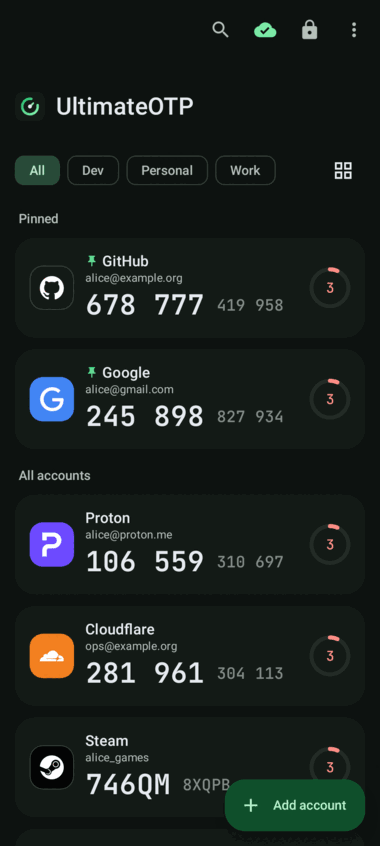
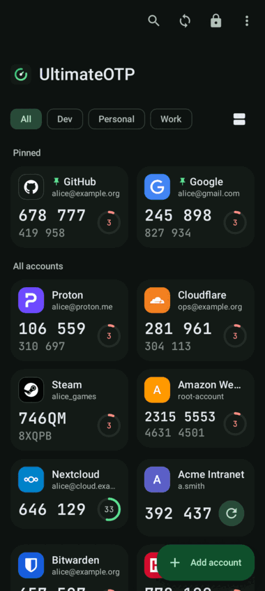
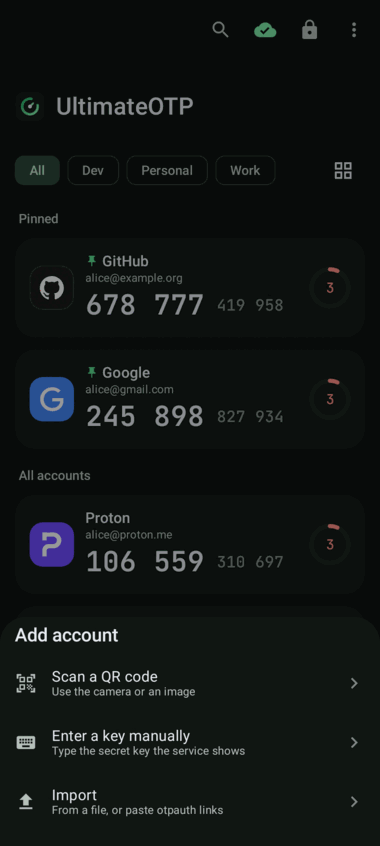
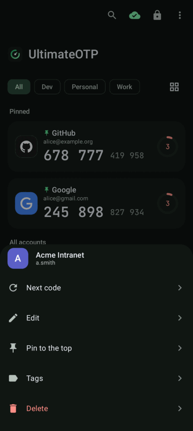
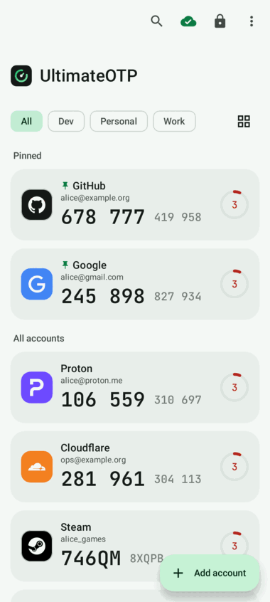
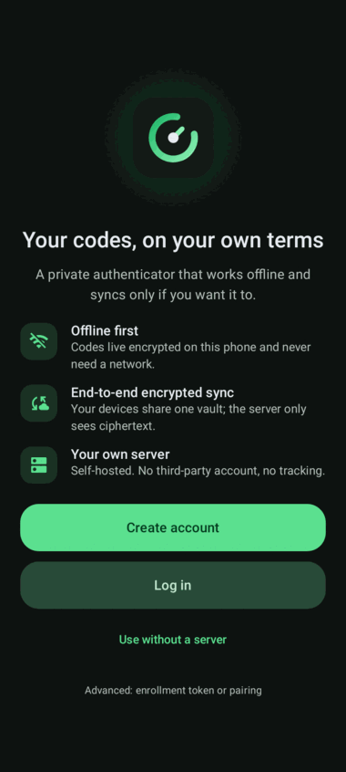
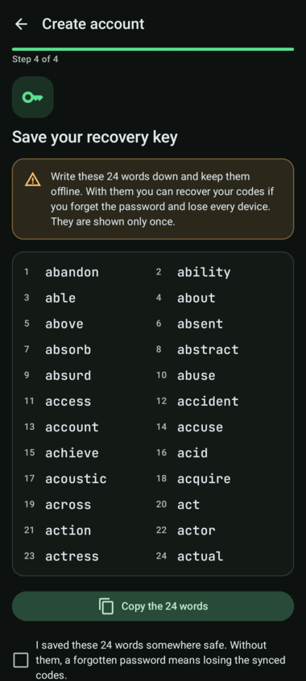
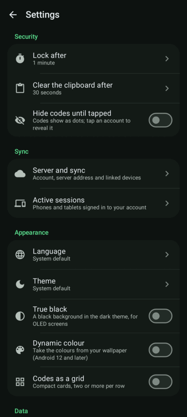
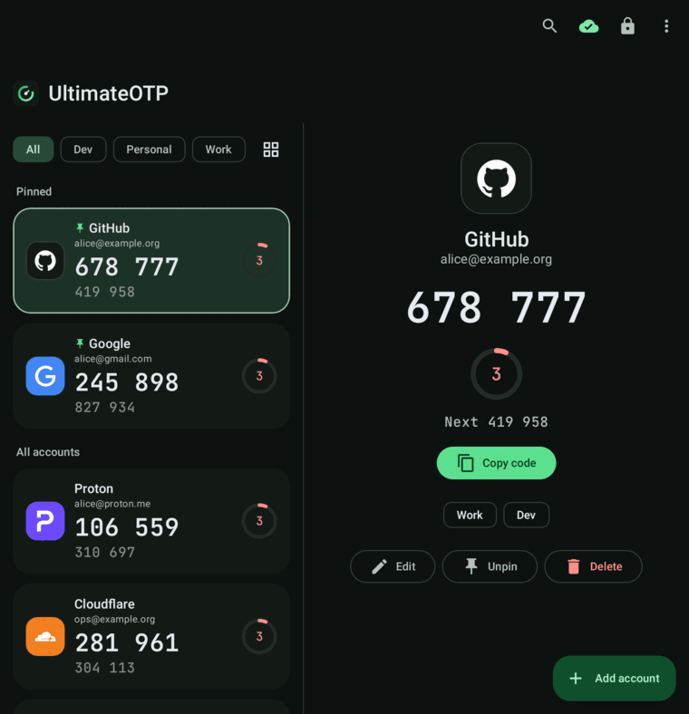

# UltimateOTP

Self-hosted, end-to-end encrypted OTP authenticator: Android app + Python backend.

Like Ente Auth, the app starts with a choice: **Create account** (email, emailed code, password
and a 24-word recovery key, on a server where the owner opened sign-up with
`UOTP_SIGNUP=enabled`), **Log in** (email, code, password) or **Use without a server**. An
enrollment token from the server's CLI and QR pairing remain available as advanced options. See
[docs/deploy.md](docs/deploy.md) §3 step 6 for setting up the first device.

- Design: [docs/design.md](docs/design.md)
- Owner decisions: [docs/decisions.md](docs/decisions.md)
- `server/`: backend (Python, FastAPI, SQLite); deployment in [docs/deploy.md](docs/deploy.md), live sync in [docs/sync.md](docs/sync.md)
- `android/`: Android app (Kotlin, Jetpack Compose)
- `contracts/`: HTTP API contract (OpenAPI)
- Releases: built and signed by GitHub Actions on a `v*` tag, see [RELEASING.md](RELEASING.md)

## The app

Dark-first, green, with the logo of each service next to its code, a fold-aware layout, light and true
black themes, and English and Spanish. Design system: [docs/design-ui.md](docs/design-ui.md); brand icons:
[docs/icons.md](docs/icons.md).

| Codes | Grid | Add | Menu |
|---|---|---|---|
|  |  |  |  |

| Light | Welcome | Recovery key | Settings |
|---|---|---|---|
|  |  |  |  |

Pixel 9 Pro Fold inner display (list and detail panes):

The screenshots are rendered on the JVM by `ScreenshotTest`, not on a device.

## Status

Early development. Not audited: do not trust it with real 2FA secrets yet.

## License

GPL-3.0-or-later. See [LICENSE](LICENSE).
